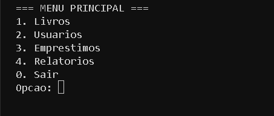
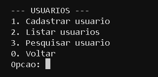

# Sistema de Gerenciamento de Biblioteca em C

Aplicação de terminal desenvolvida em linguagem C para administrar o acervo de uma biblioteca, usuários e empréstimos. O projeto demonstra o uso de estruturas (`struct`), vetores, funções, validação de entrada, manipulação de datas e persistência de dados em arquivos.

> **Contexto:** projeto acadêmico com foco em prática de lógica de programação e fundamentos da linguagem C. Não é um sistema pronto para uso em produção.

## Funcionalidades

- Cadastro, listagem e pesquisa de livros.
- Pesquisa de livros por código, título ou autor.
- Busca avançada por título, autor, editora, intervalo de publicação e disponibilidade.
- Cadastro, listagem e pesquisa de usuários por matrícula ou nome.
- Registro de empréstimos com prazo inicial de 7 dias.
- Registro de devoluções e renovação de empréstimos por mais 7 dias.
- Listagem de empréstimos ativos.
- Relatório de livros mais emprestados.
- Relatório de usuários com empréstimos em atraso.
- Salvamento e carregamento automático dos dados em arquivos de texto.
- Validação de entradas, datas, identificadores duplicados e consistência dos registros carregados.
- Criação de cópias de segurança (`.bak`) antes das gravações e uso de arquivos temporários durante a atualização dos dados.

## Tecnologias e conceitos

- **Linguagem:** C (código compatível com o padrão C11).
- **Compilador recomendado:** GCC.
- **Bibliotecas:** biblioteca padrão da linguagem C (`stdio.h`, `stdlib.h`, `string.h`, `time.h`, entre outras).
- **Conceitos aplicados:** `struct`, arrays, ponteiros, funções, laços, condicionais, validação de dados, manipulação de strings, datas, leitura e escrita de arquivos.

## Como compilar e executar

É necessário ter o GCC instalado e disponível no terminal. O programa não precisa de bibliotecas externas.

### Windows (PowerShell / terminal do VS Code)

Execute os comandos a partir da pasta principal do repositório:

```powershell
gcc -std=c11 -Wall -Wextra -Wpedantic .\src\main.c -o .\biblioteca.exe
.\biblioteca.exe
```

### Linux ou macOS

```bash
gcc -std=c11 -Wall -Wextra -Wpedantic ./src/main.c -o biblioteca
./biblioteca
```

> **Importante:** execute o programa a partir da pasta principal do projeto. Os arquivos de dados são criados no diretório de trabalho atual, e não necessariamente na pasta onde está o executável.

## Como utilizar

Ao iniciar, o sistema carrega os registros existentes e apresenta o menu principal:

```text
=== MENU PRINCIPAL ===
1. Livros
2. Usuarios
3. Emprestimos
4. Relatorios
0. Sair
```

Escolha uma opção digitando o número correspondente. Os cadastros e as operações de empréstimo são gravados automaticamente. Ao fechar e iniciar o programa novamente, os dados salvos são carregados.

Para registrar um empréstimo, primeiro cadastre um livro e um usuário. Em seguida, acesse **Empréstimos > Realizar empréstimo** e informe a matrícula do usuário e o código do livro.

Os textos cadastrados não podem conter o caractere `|`, pois ele é utilizado como separador dos campos nos arquivos de dados.

## Persistência de dados

Na primeira gravação, o programa cria os seguintes arquivos na pasta em que foi executado:

| Arquivo | Conteúdo |
|---|---|
| `livros.txt` | Cadastro e quantidade de exemplares dos livros |
| `usuarios.txt` | Dados cadastrais dos usuários |
| `emprestimos.txt` | Histórico e situação dos empréstimos |
| `*.txt.bak` | Cópias de segurança dos arquivos de dados existentes |
| `*.txt.tmp` | Arquivos temporários utilizados durante a gravação |

Os registros são armazenados em texto, com campos separados por `|`. Os arquivos de dados e os backups são ignorados pelo Git por segurança e para evitar o envio acidental de dados pessoais ao repositório.

**Privacidade:** não inclua dados reais de usuários, telefones ou qualquer informação pessoal no GitHub. Utilize apenas dados fictícios para demonstrações. Os arquivos locais são texto simples e não possuem criptografia.

## Organização do projeto

```text
gerenciador-biblioteca-c/
├── docs/
│   └── TESTES-MANUAIS.md
├── src/
│   └── main.c
├── .gitignore
└── README.md
```

O código está organizado em seções dentro de `src/main.c`: estruturas e constantes, inicialização, entrada e validação, datas, buscas e impressão, persistência, carregamento, operações principais, relatórios e menus.

## Limitações conhecidas

- Aplicação de terminal, sem interface gráfica ou interface web.
- Dados armazenados localmente em arquivos de texto; não utiliza banco de dados.
- Não possui autenticação, perfis de acesso ou criptografia dos dados.
- Limites fixos definidos no código: até 500 livros, 500 usuários e 2.000 empréstimos.
- Não há funções para editar ou excluir livros e usuários já cadastrados.
- O programa foi pensado para execução local e uso individual; não implementa controle de acesso concorrente entre várias instâncias.
- A pesquisa sem distinção entre maiúsculas e minúsculas não garante equivalência correta para todos os caracteres acentuados em UTF-8.
- O repositório não contém uma suíte automatizada de testes; há um roteiro de validação manual em `docs/TESTES-MANUAIS.md`.

## Validação realizada

O código foi compilado com GCC 14.2.0 usando as opções `-std=c11 -Wall -Wextra -Wpedantic -Wconversion -Wshadow`, sem avisos do compilador. Também foi executado um teste manual de fluxo com cadastro de livro, cadastro de usuário, realização de empréstimo e recarregamento dos registros após reiniciar o programa.

Essa validação confirma a compilação e o fluxo básico testado, mas não substitui testes completos de todas as funcionalidades e situações de erro.

## Melhorias futuras

- Separar o código em módulos (`livros`, `usuarios`, `emprestimos`, `persistencia` e `relatorios`).
- Criar testes automatizados para as regras de negócio e validações.
- Avaliar a migração da persistência para SQLite.
- Melhorar o suporte a caracteres acentuados nas pesquisas.
- Implementar edição e exclusão com validação de vínculos entre livros, usuários e empréstimos.
- Evoluir os mecanismos de segurança e integridade para um cenário multiusuário.

## Demonstração do sistema

### Menu principal

Tela inicial com acesso aos módulos de gerenciamento da biblioteca.



### Cadastro de livros

Tela de cadastro de livros, com informações como título, autor, editora e quantidade de exemplares.


### Cadastro de usuários

Tela de cadastro de usuários da biblioteca.


